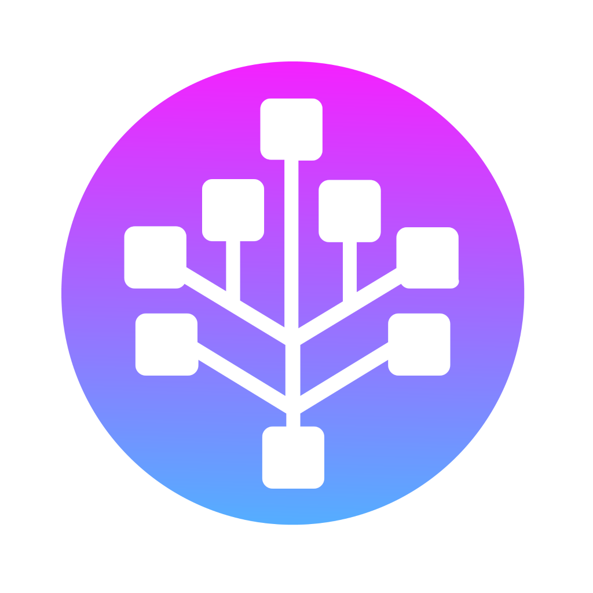
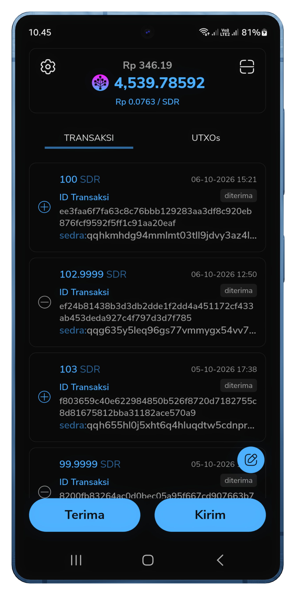
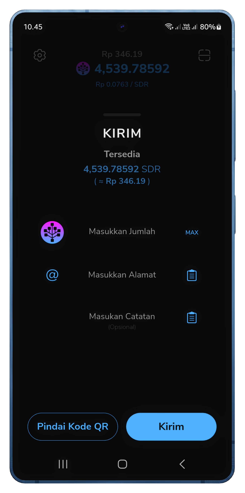
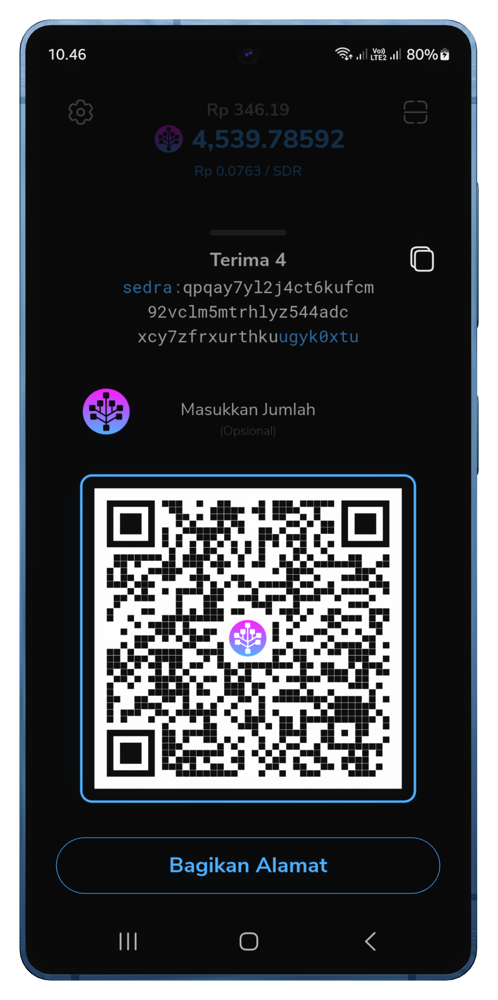
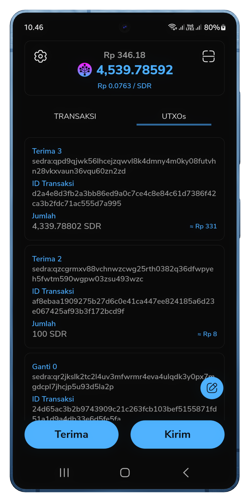
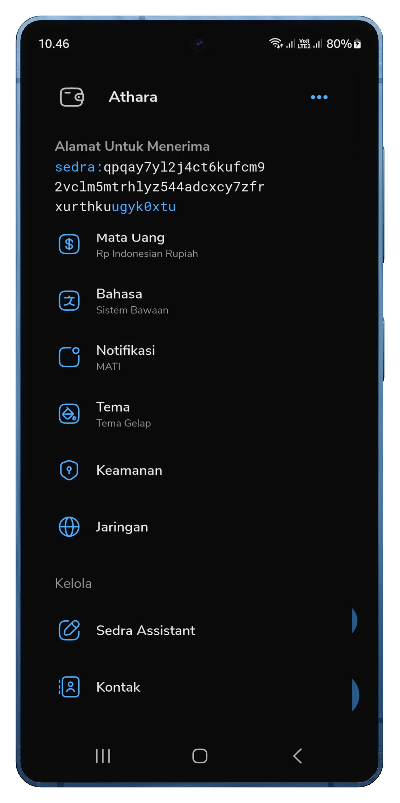
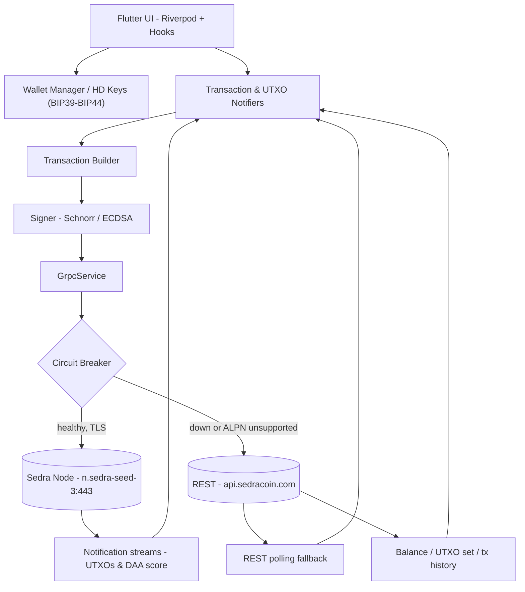
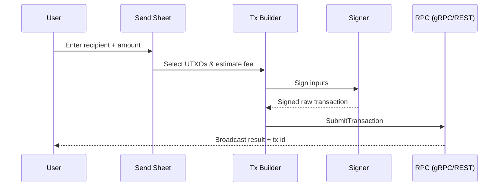

<div align="center">
  
  <h1>Sedra Wallet</h1>
  <p>The Ultimate Self-Custodial Wallet for the Sedra (SDR) Network.</p>
</div>

<p align="center">
  <a href="LICENSE"></a>
  <a href="https://github.com/karyalangitdigital/sedracoin-wallet/actions/workflows/ci.yml"></a>
  <a href="https://flutter.dev"></a>
  
  <a href="https://sedracoin.com"></a>
  
  <a href="https://github.com/karyalangitdigital/sedracoin-wallet/blob/main/CONTRIBUTING.md"></a>
  <a href="https://github.com/karyalangitdigital/sedracoin-wallet/issues"></a>
</p>

---

## Table of Contents

- [What is Sedra Wallet?](#what-is-sedra-wallet)
- [Key Features](#key-features)
  - [Core Wallet Capabilities](#core-wallet-capabilities)
  - [Built-in Sedra AI Assistant](#built-in-sedra-ai-assistant)
  - [Resilient Network Connectivity](#resilient-network-connectivity)
- [Screenshots](#screenshots)
- [Architecture](#architecture)
  - [Send-transaction flow](#send-transaction-flow)
- [Project Structure](#project-structure)
- [Building from Source](#building-from-source)
  - [Android](#android)
  - [iOS](#ios)
- [Contributing](#contributing)
- [Roadmap](#roadmap)
- [Support](#support)
- [Acknowledgments](#acknowledgments)
- [Useful Links](#useful-links)
- [License](#license)

## What is Sedra Wallet?

Sedra Wallet is a fast, secure, and intuitive self-custodial wallet designed specifically for the **Sedra** blockchain ecosystem. Built with Flutter, it interacts seamlessly with Sedra's BlockDAG / GHOSTDAG architecture, offering users full control over their funds with robust local security.

Developed by **KARYA LANGIT DIGITAL**.

## Key Features

### Core Wallet Capabilities
- **Self-Custodial & Secure**: You own your private keys. Securely stored locally using encrypted storage and protected via biometric authentication (Face ID / Fingerprint).
- **Fast Transactions**: Near-instant Sedra (SDR) transfers leveraging BlockDAG's rapid sub-second finality.
- **QR Code Support**: Effortlessly send and receive funds by scanning or sharing QR codes.
- **UTXO Management**: Native compound UTXO feature to merge small mining or transfer UTXOs into a single large UTXO for optimal speed and low fees.
- **Multilingual Support**: Available in multiple languages to support Sedra's global community.

### Built-in Sedra AI Assistant
- An integrated smart assistant powered by AI.
- Exclusively dedicated to answering questions regarding the Sedra ecosystem, BlockDAG technology, SDR tokenomics, mining (kHeavyHash), and wallet usage.
- Automatically adapts to the wallet's active language.

### Resilient Network Connectivity
- **Smart Fallback Mechanism**: Interacts with the blockchain using high-performance gRPC over HTTP/2. If the node connection fails or ALPN is unsupported, the wallet instantly and gracefully falls back to the REST API without crashing or degrading user experience.
- **Custom Node Configuration**: Flexibility to connect to custom public or private Sedra nodes (with or without TLS/SSL).

## Screenshots

<p align="center"><sub>Add your app UI captures to <code>docs/screenshots/</code> using the file names below and they will appear here.</sub></p>

<table align="center">
  <tr>
    <td align="center"><br/><sub>Home &amp; Balance</sub></td>
    <td align="center"><br/><sub>Send SDR</sub></td>
    <td align="center"><br/><sub>Receive / QR</sub></td>
  </tr>
  <tr>
    <td align="center"><br/><sub>Transaction History</sub></td>
    <td align="center"><br/><sub>UTXO Management</sub></td>
    <td align="center"><br/><sub>Settings</sub></td>
  </tr>
</table>

## Architecture

The app is organized around a **Riverpod** state layer on top of a **gRPC/REST** RPC service with a built-in **circuit breaker + REST fallback**, so balances, UTXOs, and history keep updating even when the node is unreachable.



### Send-transaction flow



## Project Structure

```text
lib/
  sedra/        # Core protocol: bip32/bip39, address, tx builder/signer, RPC (gRPC+REST), API
  wallet*/      # Wallet, keys, auth, balance, signer, home
  transactions/ # History, sync engine, cache
  utxos/        # UTXO list, selection, compounding
  send_sheet/   # Send flow UI
  receive/      # Address & QR
  settings*/    # Node, API, explorer, theme, language
  ai/ push/ coingecko/ ...  # Assistant, notifications, price feed
```

## Building from Source

To build and run Sedra Wallet locally, ensure you have the [Flutter SDK](https://flutter.dev) installed.

### Android
```bash
# Debug mode
flutter run

# Release APK
flutter build apk --release

# App Bundle for Google Play
flutter build appbundle --release
```

### iOS
```bash
# Release build for iOS
flutter build ios --release
```

## Contributing

Contributions of all kinds are welcome — bug reports, translations, code, docs. Please read [CONTRIBUTING.md](CONTRIBUTING.md) before opening a pull request. By participating, you also agree to the [Code of Conduct](CODE_OF_CONDUCT.md).

- 🐞 Report bugs / request features via the [issue templates](https://github.com/karyalangitdigital/sedracoin-wallet/issues/new/choose).
- 🛡️ Report security issues privately — see [SECURITY.md](SECURITY.md).
- 🌐 Help translate into your language — see [TRANSLATORS.md](TRANSLATORS.md).

## Roadmap

Sedra Wallet is under active development. Priorities for upcoming releases:

- [ ] Reachable TLS-enabled Sedra gRPC endpoints so real-time subscription streams replace REST polling.
- [ ] Hardware-wallet / external-signer support.
- [ ] In-app fiat on/off-ramp integrations.
- [ ] Batched multi-output transactions and BIP21 payment-request URIs.
- [ ] WalletConnect-style dApp bridge.

Suggestions and volunteers are welcome — open a feature-request issue to discuss.

## Support

- **User support / general questions:** [support@sedracoin.com](mailto:support@sedracoin.com)
- **Developer discussion:** [GitHub Discussions](https://github.com/karyalangitdigital/sedracoin-wallet/discussions)
- **Bug tracker:** [GitHub Issues](https://github.com/karyalangitdigital/sedracoin-wallet/issues)

## Acknowledgments

- The **Kaspium Wallet** authors and **Appditto LLC** — Sedra Wallet is a fork, adapted for the Sedra network.
- The **Sedra** core team for the network, block explorers and public REST endpoints.
- The Flutter, Riverpod and open-source crypto communities.
- Every translator listed in [TRANSLATORS.md](TRANSLATORS.md).

## Useful Links

- **Sedra Homepage:** [sedracoin.com](https://sedracoin.com)
- **Sedra Explorer:** [explorer.sedracoin.com](https://explorer.sedracoin.com)
- **Official Sedra Mobile Wallet (reference upstream):** [github.com/sedracoin/SedraCoinMobileWallet](https://github.com/sedracoin/SedraCoinMobileWallet)
- **Issue tracker:** [github.com/karyalangitdigital/sedracoin-wallet/issues](https://github.com/karyalangitdigital/sedracoin-wallet/issues)
- **Security policy:** [SECURITY.md](SECURITY.md)

## License

Sedra Wallet is open-source software released under the [MIT License](LICENSE) by **KARYA LANGIT DIGITAL**.

This project is a fork of [Kaspium](https://github.com/azbuky/kaspium) — originally developed by Appditto LLC and the Kaspium Wallet authors — and is adapted for the Sedra network. Upstream MIT copyright notices are retained in the [LICENSE](LICENSE) file.
